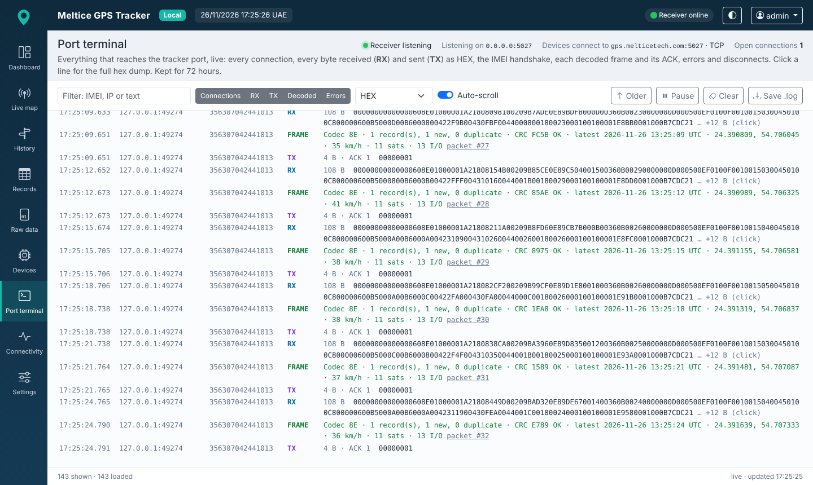

# Meltice GPS Tracker

Receives Teltonika **FMC130** telemetry over cellular TCP (Codec 8 / Codec 8 Extended), shows **every byte that
arrives on the tracker port in a live terminal**, keeps every raw packet, decodes GPS and I/O values into
**Microsoft SQL Server**, and serves the data through a web UI (light and dark theme) and a **REST API**.
Built to the *Meltice Fleet Phase 1 Scope* and the *FMC130 Connectivity Runbook*; the current focus is
connectivity testing and raw data on the Hostinger VPS.

```
FMC130 ──cellular──▶ TCP receiver :5027 ──▶ CRC + codec validation ──▶ raw packet + decoded records ──▶ SQL Server
                     (asyncio, separate          (one DB transaction, ACK only after commit)              │
                      process)  └── every connection / RX / TX byte / decoded frame / ACK ──▶ port events ─┤
Browser (login) ◀── Django web: Port terminal, Dashboard, Live map, Raw data, Connectivity ◀──────────────┤
Scripts / other systems ◀── REST API /api/v1/ (token or session auth, Swagger docs at /api/docs/) ◀─────┘
```



## What is in the box

| Area | Where |
|---|---|
| **Port terminal**: live view of everything reaching port 5027 — connections, every RX/TX byte as HEX, IMEI handshake, decoded frame summary, ACKs, errors, non-Teltonika traffic (scanners, browsers), disconnects. Filter, pause, hex dump, scroll back, save as .log | web **Port terminal**, `manage.py port_monitor` (SSH) |
| **REST API** v1: auth token, devices (CRUD), history, records + I/O, raw packets + re-decode, connections, port events (live tail), receiver status, connectivity tests | `tracking/api.py`, `/api/docs/`, `docs/API.md` |
| **Sign-in**: username + password, lockout after 5 failures, change password, roles (admin / staff / raw-data viewer / viewer) | `/login/`, user menu, `/admin/` |
| **Light / dark theme** (or follow the system), remembered per browser | theme button in the top bar |
| **SQL Server** database (2019/2022, Express is enough): least-privilege app login, setup + backup commands | `manage.py mssql_setup`, `manage.py mssql_backup` |
| Codec 8 / 8E parser, CRC-16/IBM, framing, encoder | `tracking/codec.py` |
| Async TCP receiver (IMEI allow-list, 0x01/0x00 handshake, fragmented + coalesced frames, timeouts, connection & rate limits, heartbeat) | `tracking/receiver.py` |
| Ingest: raw + records in one transaction, ACK after commit, idempotent replay, late-arrival flag, newest-fix-wins | `tracking/ingest.py` |
| FMC130 AVL I/O dictionary (versioned, unknown IDs kept) | `tracking/io_dictionary.py` |
| Screens: Dashboard, Live map, History, Records, I/O inspector, Raw data, Port terminal, Devices, Connectivity, Settings | `tracking/templates/` |
| Device simulator (multi-vehicle, Codec 8/8E, no-fix injection) | `manage.py simulate_device` |
| Connectivity / acceptance suite (13 protocol checks) | `manage.py conntest`, web **Connectivity → Run test**, `tools/fmc_probe.py` |
| Automated tests (37, run against SQL Server) | `tracking/tests/` |
| Local hosting with Docker (SQL Server 2022 + web + receiver) | `docker-compose.yml`, `Dockerfile` |
| Hostinger VPS hosting (SQL Server in Docker or external, systemd + Nginx) | `deploy/hostinger/`, `docs/HOSTINGER_DEPLOYMENT.md` |
| Physical FMC130 bench test guide | `docs/DEVICE_BENCH_TEST.md` |

---

## Option A — Local hosting

### A1. Docker (recommended, any OS with Docker Desktop) — includes SQL Server 2022

```bash
cp .env.example .env            # set FLEET_ADMIN_PASSWORD, MSSQL_SA_PASSWORD, FLEET_DB_PASSWORD, FLEET_SECRET_KEY
docker compose up -d --build    # first start pulls SQL Server and creates the database (1-2 minutes)
docker compose --profile sim up -d simulator     # optional: 3 simulated vehicles driving in Abu Dhabi
```

* Web UI: <http://127.0.0.1:8000> (login `admin` / the password from `.env`) → **Port terminal**
* Tracker TCP port: `5027` on all interfaces of your PC
* SQL Server: `127.0.0.1,1433` from this PC only (SSMS / Azure Data Studio; app login `fleet_app`)
* Terminal in your shell: `docker compose exec web python manage.py port_monitor`
* Logs: `docker compose logs -f receiver`
* Stop: `docker compose --profile sim down` (data stays in the volumes; add `-v` to wipe it)

SQL Server passwords must be 8+ characters with upper case, lower case, a digit and a symbol.

### A2. Plain Python (Windows / macOS / Linux, Python 3.10+) with your own SQL Server

Install the **Microsoft ODBC Driver 18 for SQL Server** first (Windows: Microsoft download page;
Ubuntu: see `deploy/hostinger/install.sh`; macOS: `brew install msodbcsql18`). Any SQL Server 2019/2022
works, including Express or Developer edition on your PC.

```powershell
python -m venv .venv
.venv\Scripts\activate            # macOS/Linux: source .venv/bin/activate
pip install -r requirements.txt
copy .env.example .env            # macOS/Linux: cp; set FLEET_DB_HOST / FLEET_DB_PASSWORD / FLEET_ADMIN_PASSWORD
$env:FLEET_DB_ADMIN_PASSWORD="<sa password>"; python manage.py mssql_setup   # creates database + fleet_app login
python manage.py migrate
python manage.py createcachetable
python manage.py ensure_admin
python manage.py seed_demo        # optional demo vehicles + 2 h of history
```

No SQL Server at hand? `FLEET_DB_ENGINE=sqlite` in `.env` runs everything on a single file for a quick trial.

Then run the two processes in **separate terminals** (they are deliberately independent):

```powershell
python manage.py run_receiver --host 0.0.0.0 --port 5027
python manage.py runserver 127.0.0.1:8000
```

On Windows, `tools\start_local.ps1` opens both for you. Check the listener with
`Get-NetTCPConnection -LocalPort 5027 -State Listen` and `Test-NetConnection -ComputerName 127.0.0.1 -Port 5027`.

### Test connectivity locally

```bash
python manage.py conntest                       # 13 protocol acceptance checks against 127.0.0.1:5027
python manage.py simulate_device --interval 5   # one simulated FMC130 (Ctrl+C to stop)
python manage.py simulate_device --imei 356307042441021,356307042441054 --codec 8 --no-fix-every 10
python manage.py test tracking                  # unit + end-to-end tests (creates a temporary SQL Server test database)
```

Or open **Connectivity → Run test** in the web UI. To connect the real FMC130 to your PC you need a
public TCP path (router port-forward or raw-TCP tunnel) — see `docs/DEVICE_BENCH_TEST.md`.

---

## Option B — Hostinger hosting

Requires a **Hostinger VPS** (KVM 1 or larger — SQL Server needs 2 GB RAM; Ubuntu 22.04/24.04). Shared / Cloud web hosting cannot run a raw
TCP listener on port 5027, so it cannot receive tracker data.

```bash
# on the VPS (git clone https://github.com/connectbishar-byte/meltice-gps-tracker.git && cd meltice-gps-tracker)
sudo bash deploy/hostinger/install.sh      # SQL Server 2022 Express in Docker on 127.0.0.1:1433 + app + Nginx
# existing SQL Server instead:  sudo DB_MODE=external DB_HOST=... DB_NAME=... DB_USER=... DB_PASSWORD=... bash deploy/hostinger/install.sh
sudo certbot --nginx -d fleet.melticetech.com
sudo ufw allow 5027/tcp      # only if UFW is active — and open 5027 in hPanel's VPS firewall
```

Result: web at `https://fleet.melticetech.com` (Nginx → gunicorn `127.0.0.1:9040`), tracker endpoint
`gps.melticetech.com:5027`, services `gunicorn-fleet` and `fleet-receiver`. Full walkthrough including
DNS, SQL Server, Docker alternative, verification and rollback: **`docs/HOSTINGER_DEPLOYMENT.md`**.

Prove the VPS is reachable from the internet (run on your PC, not on the VPS):

```bash
python tools/fmc_probe.py gps.melticetech.com 5027
```

---

---

## Port terminal — see everything arriving on the port

Web: **Port terminal** in the left menu (staff and `raw_data` users). Each line is one event:

| Label | Meaning |
|---|---|
| `CONN` / `CLOSE` | TCP connection opened / closed, with reason, duration and frame count |
| `RX` | bytes received, exactly as they arrived (HEX, optional ASCII) — handshake, frames, or anything else |
| `IMEI` | handshake result: accepted, or rejected because the IMEI is not registered / disabled |
| `TX` | bytes the server sent: `01` / `00` handshake reply, 4-byte ACK |
| `FRAME` | decoded summary: codec, record count, new/duplicate, CRC, latest position, speed, satellites, I/O count; links to the stored packet |
| `ERROR` | bad CRC, framing error, non-Teltonika data (e.g. `GET / HTTP/1.1` from a scanner), database failure |
| `REFUSED` | connection limit or per-IP rate limit hit |

Filter by IMEI, IP or any text (including HEX), switch event types on/off, pause, load older events,
click a line for a full hex dump, and **Save .log**. Events are kept `FLEET_PORT_LOG_RETENTION_HOURS` (72 h).

Over SSH on the VPS:

```bash
sudo -u fleet bash -c 'set -a; . /etc/meltice-gps-tracker/fleet.env; cd /srv/meltice-gps-tracker/app; \
  /srv/meltice-gps-tracker/venv/bin/python manage.py port_monitor'          # follow live, Ctrl+C to stop
#   --imei 356307042441013   --remote 100.64.   --kind rx,tx   --spaced   --no-follow -n 500 > capture.log
```

**Commissioning a tracker whose IMEI you don't know yet:** set `FLEET_AUTO_REGISTER_UNKNOWN=true`, restart
the receiver, power the device and watch the terminal; it is registered automatically as
"Auto-registered 1234". Switch the setting back off afterwards.

## REST API

Interactive docs: **`/api/docs/`** (Swagger, sign in first) and `/api/redoc/`. Full guide: `docs/API.md`.

```bash
TOKEN=$(curl -s -X POST https://fleet.melticetech.com/api/v1/auth/token/ \
        -H 'Content-Type: application/json' -d '{"username":"admin","password":"..."}' | jq -r .token)
curl -H "Authorization: Token $TOKEN" https://fleet.melticetech.com/api/v1/devices/
curl -H "Authorization: Token $TOKEN" "https://fleet.melticetech.com/api/v1/port-events/?tail=50&kind=rx,frame"
```

| Endpoint | |
|---|---|
| `POST/DELETE /api/v1/auth/token/`, `GET /api/v1/auth/me/` | get / revoke a token, who am I |
| `/api/v1/devices/` (+ `/{id}/history/`) | list, register, edit devices (writes: staff); route points |
| `/api/v1/records/` (+ `/{id}/`) | decoded AVL records, detail with all I/O elements |
| `/api/v1/packets/` (+ `/{id}/`) | raw frames with CRC/parse/ACK status; detail re-decodes the HEX |
| `/api/v1/port-events/?after=<id>` | live port event stream (what the terminal shows) |
| `/api/v1/connections/`, `/api/v1/receiver/` | TCP connections incl. rejected handshakes; receiver health |
| `/api/v1/tests/`, `POST /api/v1/tests/run/` | connectivity self-test results; run one (staff) |

## Configuration

All settings are environment variables (`.env` locally, `/etc/meltice-gps-tracker/fleet.env` on Hostinger);
see `.env.example`. Key ones: `FLEET_DB_ENGINE` (`mssql` default, `sqlite` for a quick trial), `FLEET_DB_*`,
`FLEET_PORT_LOG*`, `FLEET_AUTO_REGISTER_UNKNOWN`, `FLEET_LOGIN_MAX_FAILURES`,
`FLEET_PUBLIC_GPS_HOST/PORT` (what the device is configured with), `FLEET_MAX_CONNECTIONS`,
`FLEET_CONNECTS_PER_MINUTE_PER_IP`, `FLEET_READ_TIMEOUT`, `FLEET_STALE_AFTER_SECONDS`.

## Users and access

* Everything (web and API) requires login with a username and password; API clients use a token.
  After 5 failed sign-ins the username is locked for 15 minutes (`FLEET_LOGIN_*`).
* Roles: **Administrator** (superuser: manage users in the user menu → *Manage users*), **Staff**
  (register devices, run self-tests, raw data), **Raw-data viewer** (member of the `raw_data` group:
  raw packets + port terminal), **Viewer** (map, history, records; IMEIs masked).
* Create users in *Manage users* (`/admin/`); everyone can change their own password from the user menu.
* Raw CSV export masks IMEIs (`3563*******1013`).
* The IMEI allow-list identifies devices; it is **not** authentication. Use carrier restrictions /
  a controlled test network, and evaluate device TLS before production.

## Behaviour notes (from the scope)

* ACK (4-byte record count) is sent **only after** raw packet and records are committed. A DB
  failure closes the link with no ACK, so the device keeps and resends its data.
* Bad CRC / malformed frames are stored (bounded) with the error and answered with ACK 0.
* Replays are idempotent: `(device, record fingerprint)` is unique; the arrival is still logged.
* Records whose device time is older than the newest seen are flagged **late**; they never move the
  map pin backwards. Records without a GNSS fix (0 satellites or 0/0) are stored but never plotted.
* Timestamps are stored in UTC and shown in UAE time (`Asia/Dubai`).
* Fuel, RPM, temperature etc. are only shown if the device actually sends them — nothing is fabricated.

## Not in Phase 1

Multi-tenancy, billing, mobile apps, remote immobilisation, Codec 12 commands, CAN/OBD, AI features
(geofences, trips, driver behaviour, alerts — roadmap).
